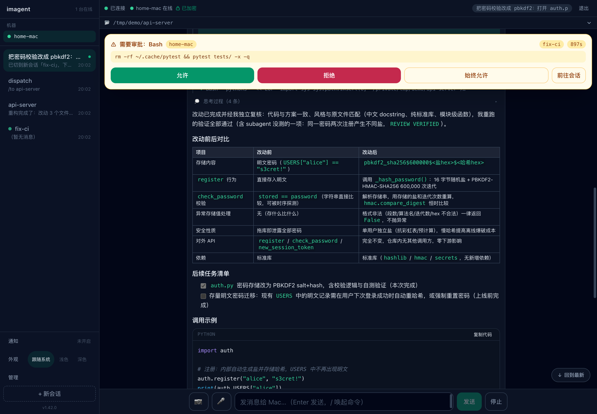
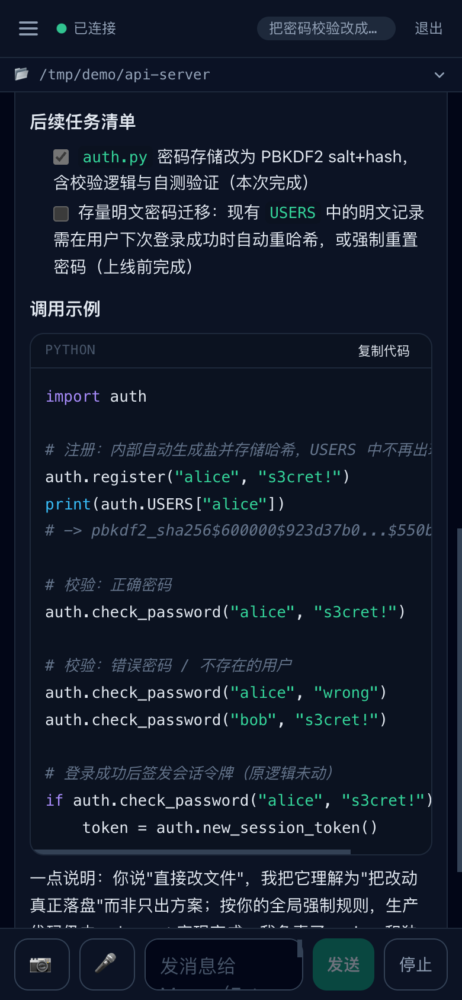
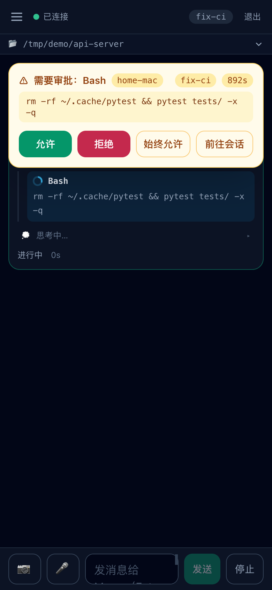

# imagent

> **Instant messaging, meet your agent.**

把 Claude Code、Codex、Gemini 这些 agent 接到你的聊天软件和手机上。agent 要做危险的事——删文件、跑命令、推送代码——会先发给你，你点一下「允许」才放行。

imagent 是一个 Rust 写的单二进制网关。一端连着你的聊天工具：飞书、企业微信、微信，或者自带的网页驾驶舱；另一端连着跑在你自己电脑上的 agent。代码和凭据都留在你的机器上。

    

> **English TL;DR** — A Rust gateway that connects coding agents (Claude Code / Codex / Gemini / any ACP agent) to the chat apps you already use — Feishu, WeCom, WeChat — or to a self-hosted web cockpit you can open on your phone. Dangerous tool calls are held for your approval: an approval card lands in your chat or browser, and nothing runs until you tap allow. The cockpit works through your own relay with zero inbound ports on your machine and end-to-end encrypted traffic.
> **Unofficial — not affiliated with Tencent or Anthropic.** WeChat support (iLink) is a third-party implementation of Tencent's OpenClaw Weixin protocol. The docs are in Chinese; the project targets the WeChat ecosystem.

## 先看一眼

网页驾驶舱。左边是电脑上的各个会话，中间是 agent 的执行过程和回复，需要你批准的操作置顶显示：



手机上是一样的界面，可以添加到主屏幕当 App 用：

| 对话与执行过程 | 审批 |
|---|---|
|  |  |

## 它能帮你做什么

**在聊天软件里使唤 agent。** 给飞书 / 企业微信 / 微信里的 bot 发一句话，电脑上的 agent 就开始干活，结果流式回到对话里。

```
你（手机飞书）    把 ~/data/results.csv 画成趋势图，发到「数据组」群

agent            需要执行 Bash(python ~/plot.py ~/data/results.csv)
                  🔐 权限审批卡 →  [✅ 允许]  [⛔ 拒绝]  [始终允许]

你                （点「允许」）

agent            ✅ 已完成 → 📊 chart.png 已发到「数据组」群
                  ⚙️ Bash · 1.2s    📎 Read ~/plot.py → Write ~/out/chart.png
```

**出门在外，用手机驾驶电脑上的 agent。** 网页驾驶舱可以同时连家里和公司的多台电脑：看流式输出、看它改了哪些文件、批审批、随时叫停。任务跑完或等你审批时手机会收到推送；不方便打字可以说话，识别在你自己的电脑上完成。

**遥控电脑上已经开着的 Claude Code 窗口。** 不用关掉重开、不用改任何设置：网关会把自己注册成这些窗口的「同行」，你在驾驶舱里发的话直接送进那个窗口，窗口里的 Claude 也可以随时把进展发回你的手机。

**终端里的 agent 有问题，来手机上问你。** 电脑上任何 agent（Claude Code、Codex 等）遇到需要你拍板的事，可以把问题发到飞书，你在手机上点选答案，答案回到终端。

## 快速开始

支持 macOS（Apple Silicon / Intel）和 Linux x86_64，需要 Rust 1.88+ 才能从源码构建。

```bash
# 一键安装：下载二进制（带 sha256 校验）→ 生成配置 → 挂载 MCP。已有配置不会被覆盖
bash <(curl -fsSL https://raw.githubusercontent.com/uzziahlin/imagent/main/install.sh)
```

也可以从 [Releases](https://github.com/uzziahlin/imagent/releases) 直接下载 `imagent-darwin-arm64` / `imagent-darwin-x86_64` / `imagent-linux-x86_64`，或自己构建：

```bash
git clone https://github.com/uzziahlin/imagent && cd imagent
cargo build --release        # 产物在 target/release/imagent
```

> **macOS 注意**：系统里也有一个叫 `imagent` 的输入法进程。停本程序请用前台 `Ctrl-C`，**不要 `pkill imagent`**。

### 路径 A：在飞书里用（约 5 分钟）

```bash
mkdir -p ~/.imagent
cat > ~/.imagent/config.toml <<'EOF'
default_workdir = "/absolute/path/to/agent/workspace"   # 必填：agent 的工作目录
platform = "feishu"
feishu_app_id = "cli_xxx"     # 飞书开放平台「凭证与基础信息」页
allowed_senders = []          # 先留空：第一次收到消息时，日志会打出你的 open_id
EOF
export IMAGENT_FEISHU_APP_SECRET="你的 App Secret"      # secret 不写进配置文件

imagent start                 # 前台运行；日志出现 connected to wss://msg-frontier.feishu.cn 即成功
# 在飞书里给 bot 发一条消息 → 日志打出你的 ou_xxx →
imagent allow ou_xxx          # 授权自己
```

飞书应用的创建、事件订阅、权限开通见下文折叠块「飞书完整接入流程」，或者直接跑向导 `imagent setup --platform feishu`。企业微信和个人微信的接法见[配置参考](docs/CONFIG.md)。

### 路径 B：手机驾驶舱

分三步，中继只需要部署一次：

1. **部署中继**：一台有域名的服务器上跑 `imagent-relay`，放在 Caddy 后面。前端页面已经内嵌在中继里，不用单独部署。步骤见 [docs/WEB_DEPLOY.md](docs/WEB_DEPLOY.md)。
2. **接入你的电脑**：

   ```bash
   imagent join --relay wss://你的域名:8443/imagent/gateway --name home-mac --workdir ~/work
   # 它会生成这台电脑的密钥、写好配置，并打印一串公钥
   ```

   第一台电脑的公钥要写进中继的环境变量 `IMAGENT_RELAY_GATEWAY_KEYS`，中继才肯启动；之后再接入的电脑，直接把公钥填进驾驶舱的「管理 → 机器管理 → 添加」即可。最后在 `config.toml` 的 `allowed_senders` 里加上 `"web:user"`，`imagent start`。
3. **打开手机浏览器**：访问 `https://你的域名:8443/imagent/`，用访问令牌登录。第一次连接会让你核对这台电脑的加密指纹，和管理页里显示的一致就点信任。iPhone 上可以用「添加到主屏幕」装成 App，这样任务完成、需要审批时能收到推送。

家里和公司各跑一台的话，每台电脑重复第 2 步，给不同的 `--name`。

### 路径 C：遥控已开着的 Claude Code 窗口

前提是已经按路径 B 接好了驾驶舱。在 `config.toml` 里打开开关并重启网关：

```toml
peer_enabled = true          # 缺省 false；可选 peer_name = "imagent"（窗口里看到的网关名字）
```

- **从驾驶舱派活**：发 `/peers` 列出当前在线的窗口，发 `/to 窗口名` 进入和它的对话，之后直接打字即可。窗口空闲时会自动开始处理。
- **从窗口汇报**：在那个 Claude Code 窗口里让它「用 SendMessage 发给 imagent」，消息会出现在驾驶舱里，手机同时收到推送。

这条路走的是 Claude Code 的跨会话消息机制，属于非官方接口；Claude Code 升级后如果协议变了，这里需要跟进适配。

## 它是怎么工作的

```
飞书 │ 企业微信 │ 微信 │ 网页驾驶舱 │ 本地终端 │ 终端 agent（MCP）
                          │
                    imagent 网关（单个二进制）
        鉴权 · 会话 · 任务控制 · 权限审批 · 定时任务 · 用量统计
                          │
      Claude Code │ Codex │ Gemini │ 任意 ACP agent
```

网关在中间做三件事：把消息从任意入口路由到对应会话；在 agent 调用危险工具时暂停，等你批准；把执行过程和结果流式送回你所在的那个入口。各个入口和各个 agent 引擎是解耦的，可以同进程并存、按会话切换引擎。

网页驾驶舱多一个中继：电脑上的网关主动向中继建连（电脑不开放任何端口），浏览器也连中继。中继只负责转发，业务内容端到端加密，它看不到明文——唯一的例外是手机推送的标题，那里带有消息的开头（最多 32 个字）。

## 安全

- **谁能用**：发送者白名单 + 会话白名单，没授权的消息直接丢弃。
- **agent 能做什么**：`allowed_tools` 限定可用工具，工作目录锁定；危险操作走审批，没有你的允许不会执行。
- **agent 碰不到什么**：`~/.imagent` 状态目录对 agent 隐藏；可选 OS 级沙箱（macOS Seatbelt / Linux bwrap）在内核层兜底，挡住对 `~/.ssh`、shell 配置等的写入。
- **驾驶舱**：电脑零入站端口；网关身份用 ed25519 密钥，中继只存公钥；流量端到端加密；支持 passkey 登录，登录会话可随时吊销。

审批约束的是「agent 发起的工具调用」，管不到同一用户下其它进程的读写。多人群组部署前请务必读 [SECURITY.md](SECURITY.md) 的威胁模型。

## 支持范围

**入口**

| 入口 | 能力 |
|---|---|
| 飞书 | 私聊 / 群 / 云文档评论；流式卡片、按钮审批、语音转文字 |
| 企业微信 | 单聊文本；按钮交互降级为文字 y/n |
| 微信（个人号） | 私聊；实验性，账号风险见文末免责声明 |
| 网页驾驶舱 | 手机 / 桌面浏览器，多台电脑；完整的卡片、审批、推送、语音 |
| 本地终端 | `imagent claude`：终端只是个视图，关掉窗口会话继续跑 |

**agent 引擎**

| 引擎 | 审批闭环 | 说明 |
|---|---|---|
| Claude Code（`claude-cli`，默认） | ✅ | 每轮一个进程；支持 OS 级沙箱 |
| Claude Code（`claude-acp`） | ✅ | 长驻子进程，省去每轮的启动开销 |
| Codex（`codex-app`） | ✅ | 官方 app-server 协议；`codex` 为一次性调用模式 |
| Gemini | — | `gemini -p` |
| 任意 ACP agent | 取决于该 agent | 配 `acp_command` |

引擎可以在同一个网关里并存，用 `/backend` 按会话切换。

## 常用命令

在任意入口（飞书、驾驶舱、终端）里直接发：

| 命令 | 作用 |
|---|---|
| `/new`、`/switch <名字>` | 开新会话、在多个会话之间切换 |
| `/resume` | 恢复历史会话，或接管电脑上已开的 Claude Code 会话 |
| `/stop` | 中断当前任务 |
| `/tasks`、`/status` | 看进度、看上下文用量 |
| `/model`、`/backend`、`/effort` | 切模型、切引擎、调思考深度 |
| `/perm` | 切换权限模式（`ask` = 每个操作都问） |
| `/cron add */10 * * * * 检查构建` | 定时任务 |
| `/peers`、`/to <窗口名>` | 遥控本地 Claude Code 窗口 |
| `/doctor` | 自检 |

完整列表见 [docs/COMMANDS.md](docs/COMMANDS.md)，逐键配置见 [docs/CONFIG.md](docs/CONFIG.md)。

<details>
<summary><b>更多能力</b></summary>

- **定时任务** `/cron`：5 字段 cron 表达式，停机期间错过的任务按配置补跑。
- **事件入站**：`POST /hook/<token>` 把 CI 失败、监控告警送进指定会话，和手打消息走同样的鉴权与审批。
- **委托编排**：给 agent 配副后端（比如让 Codex 审 Claude 写的代码），副任务默认只读、预算只能调低。
- **飞书多维表格**：agent 把任务清单、巡检结果直接写进多维表格，配 `/cron` 就是现成的台账。
- **终端 agent 反向提问**（`ask_via_im`）：把 `imagent mcp-ask` 挂到任意终端 agent 的 MCP 配置里，它就能把问题发到飞书等你点选：

  ```bash
  imagent mcp-ask --print-config          # 输出可粘贴的 mcpServers JSON
  claude mcp add imagent -- /usr/local/bin/imagent mcp-ask
  ```

- **驾驶舱语音输入**：手机录音、电脑上 `whisper-cli` 识别，不上云。配 `whisper_bin` + `whisper_model` 两个键启用。
- **崩溃不丢消息**：会话和排队消息落 SQLite，`kill -9` 或断电后自动恢复；执行到一半的轮次用 `/retry` 续跑。
- **多实例**：`imagent profile create work` 建第二个实例，配置、数据库、套接字完全隔离，可导出导入跨机迁移。

</details>

<details>
<summary><b>飞书完整接入流程</b></summary>

走企业自建应用 + 长连接，不需要公网 IP、域名或证书。全程约 10 分钟，`imagent setup --platform feishu` 可以交互式走一遍并校验连通性。

**① 创建应用**：[open.feishu.cn/app](https://open.feishu.cn/app) →「创建企业自建应用」→「添加应用能力」→ 启用**机器人**。

**② 事件订阅**：「事件与回调」→ 选**使用长连接接收事件**，添加：

| 事件 | 用途 | 必须 |
|---|---|---|
| `im.message.receive_v1` | 收私聊 / 群 @ 消息 | ✅ |
| `card.action.trigger` | 卡片按钮回调（审批 / 问题 / 命令卡） | ✅ |
| `drive.file.comment.created_v1` | 云文档评论 @bot 触发 | 可选 |
| `im.message.recalled_v1` | 撤回：移出排队消息 | 可选 |
| `im.chat.member.bot.deleted_v1` / `added_v1` | bot 进出群：白名单维护 / 欢迎语 | 可选 |
| `im.message.reaction.created_v1` | 表情回应快速审批（👍/👎） | 可选 |
| `application.url.menu_v6` | 自定义菜单点击回 /help | 可选 |

**③ 开通权限并发布**：`im:message`（必须）、`im:message.group_at_msg`（群 @ 消息；要收全部群消息改用 `group_msg`）；可选 `cardkit:card:write`（流式卡片，缺省降级为整卡刷新）、`drive:comment`、`bitable:app`。

**④ 发布生效**：「版本管理与发布」→ 创建版本并发布。权限和事件订阅都要发布后才生效，这一步最容易漏。

**⑤ 配置凭据并启动**：见上文「快速开始 → 路径 A」。

</details>

<details>
<summary><b>运维：后台常驻、备份、多实例</b></summary>

**后台常驻**。前台验证可用后，装成系统服务（崩溃自动拉起、开机自启）：

```bash
export IMAGENT_FEISHU_APP_SECRET="..."   # 在当前 shell 导出；install 会把它快照进服务定义
imagent service install                  # 二进制先放到稳定路径（如 /usr/local/bin）再装
imagent service status / uninstall / print
```

| | macOS（launchd） | Linux（systemd 用户单元） |
|---|---|---|
| 日志 | `~/.imagent/logs/daemon.log`（50MB 轮转） | `journalctl --user -u imagent -f` |
| 无人登录也运行 | 天然支持 | 需 `loginctl enable-linger $USER` |

**备份**。运行中即可备份，每份含 SQLite 一致性快照 + 配置副本 + 清单，自动保留最近 10 份：

```bash
imagent backup                    # 默认 <imagent_home>/backups/
imagent --profile work backup     # 多实例
```

**恢复**：停止 imagent → 用快照替换主库（旧的 `-wal` / `-shm` 一并删掉）→ 放回配置 → 重新登录凭据 → 启动（数据库结构自动向前迁移）。

```bash
cp imagent-backup-*/imagent.db.snapshot ~/.imagent/imagent.db
rm -f ~/.imagent/imagent.db-wal ~/.imagent/imagent.db-shm && imagent start
```

> 新版本生成的备份无法被旧版本打开。回退二进制请用升级**前**的备份。

**多实例**。`imagent profile create work` → `imagent --profile work start`，配置、数据库、套接字、媒体目录完全隔离；`imagent profile export / import` 跨机迁移。

</details>

## 开发

```bash
cargo test --workspace                                   # Rust
cargo clippy --workspace --all-targets -- -D warnings
cargo fmt --all --check
(cd web-ui && npm test)                                  # 网页驾驶舱（vitest）
```

`core` 是调度、鉴权、会话、审批与任务控制；`feishu` / `wecom` / `ilink` / `web` / `localterm` 是各个入口；`claude` / `codex` / `gemini` 是各个引擎；`store` 是 SQLite 持久化；`relay` 是驾驶舱中继（独立二进制）；`web-ui` 是驾驶舱前端，构建产物内嵌在中继里。

## 文档

| 文档 | 内容 |
|---|---|
| [docs/CONFIG.md](docs/CONFIG.md) | 逐键配置参考 |
| [docs/COMMANDS.md](docs/COMMANDS.md) | 命令全量参考 |
| [docs/WEB_DEPLOY.md](docs/WEB_DEPLOY.md) | 驾驶舱中继：部署、接入新电脑、升级 |
| [docs/ARCHITECTURE.md](docs/ARCHITECTURE.md) | 架构说明 |
| [docs/WEB_DESIGN.md](docs/WEB_DESIGN.md) | 驾驶舱设计（中继 / 帧协议 / 安全分层） |
| [docs/FEISHU_DESIGN.md](docs/FEISHU_DESIGN.md) | 飞书平台设计 |
| [docs/RESEARCH.md](docs/RESEARCH.md) | 微信 iLink 协议与合规调研 |
| [SECURITY.md](SECURITY.md) | 安全与威胁模型 |
| [CHANGELOG.md](CHANGELOG.md) | 版本变更记录 |

## 免责声明

imagent 是**非官方**的第三方开源项目，**与腾讯、Anthropic 没有任何隶属关系**。微信接入基于腾讯公开的 [OpenClaw Weixin channel 协议](https://github.com/Tencent/openclaw-weixin)做的第三方实现；使用可能违反微信或腾讯的服务条款，**账号风险自负**，建议用小号。项目只做服从式退避（被限流就等待），不实现任何绕过频率限制或风控的功能。仅供学习研究，详见 [docs/RESEARCH.md](docs/RESEARCH.md)。

## License

MIT（见 [LICENSE](LICENSE)）。iLink 协议出处：腾讯官方 [`@tencent-weixin/openclaw-weixin`](https://github.com/Tencent/openclaw-weixin) / [ClawBot 文档](https://developers.weixin.qq.com/doc/aispeech/knowledge/openapi/Clawbotrelated.html)。
